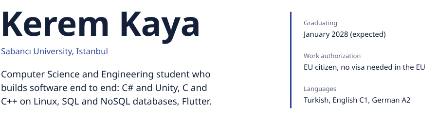

<picture>
  <source media="(prefers-color-scheme: dark)" srcset="assets/header-dark.svg">
  
</picture>

[Email](mailto:keremkaya0541@hotmail.com) &nbsp;&nbsp; [LinkedIn](https://www.linkedin.com/in/kerem-kaya-5918a1281)

 

### Education

**Sabancı University**, BSc Computer Science and Engineering 
2023 to January 2028 (expected). 100% merit scholarship; ranked 224th nationally in the 2023 YKS university entrance exam.

**Istanbul University**, Business Administration (open education faculty) 
In progress, alongside my degree at Sabancı.

Relevant coursework: Object-Oriented Programming, Data Structures and Algorithms, Operating Systems, Database Systems, Digital Logic Design, Discrete Mathematics.

### Research

**Coding theory research project**, one semester 
Studied Hamming, Golay, Kerdock, perfect and nearly perfect codes. Developed and formalized pair covering codes, analyzed their distance, covering radius and error correction, and wrote the technical report.

### Skills

**Programming:** C#, C, C++, Python, SQL, Dart, PHP, Verilog 
**Software engineering:** object-oriented design, modular code, Git and GitHub, debugging, automated testing 
**Algorithms:** data structures; graph algorithms such as Dijkstra, BFS and Kruskal; time complexity and performance analysis 
**Systems:** Linux systems programming: processes, multithreading, synchronization, memory management 
**Databases:** MySQL with stored procedures and triggers, MongoDB, Firebase Authentication, Cloud Firestore 
**Hardware:** Verilog, finite-state machine design, UART communication 
**Tools:** Unity, Android, Flutter, Blender, VS Code, XAMPP

**Spoken languages:** Turkish (native), English (C1), German (A2), Bulgarian (A1)

### Projects

On GitHub:

| Project | What it is |
|---|---|
| [FTactics](https://github.com/keremSU/FTactics-Showcase) | Android football management game with a real-time 3D match simulation and multi-season careers. Solo developer. Unity, C# |
| [Library Borrowing System](https://github.com/keremSU/library-database-system) | Borrow and return workflows enforced with MySQL triggers and stored procedures, plus MongoDB support tickets. PHP |
| [UART Countdown Timer](https://github.com/keremSU/fpga-uart-countdown-timer) | A time typed over a serial connection counts down on a 7-segment display. Verilog on an FPGA |
| [Wear2Weather](https://github.com/keremSU/CS-310-Group-Project-Group06) | Team project. Outfit suggestions from the weather and personal comfort; I led testing and QA. Flutter, Firebase |

Not public yet:

- **Real Estate CRM**, a mobile app for property listings, clients, requests and appointments, with search and customer-property matching. Flutter, Cloud Firestore
- **AI Sleep Assistant**, a mobile app for sleep logging and habit tracking with AI-assisted recommendations. Flutter, Firebase
