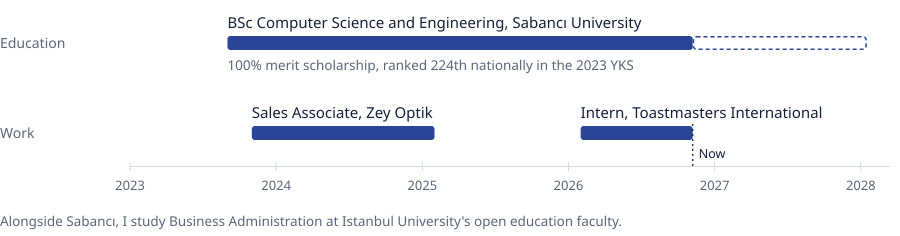

<picture>
  <source media="(prefers-color-scheme: dark)" srcset="assets/hero-dark.svg">
  
</picture>

[Email](mailto:keremkaya0541@hotmail.com) &nbsp;&nbsp; [LinkedIn](https://www.linkedin.com/in/kerem-kaya-5918a1281) &nbsp;&nbsp; EU citizen, able to work anywhere in the EU without visa sponsorship

 

### Projects

| | |
|---|---|
| **[FTactics](https://keremsu.github.io/FTactics-Showcase/)** | Android football management game with a real-time 3D match simulation and multi-season careers. Solo developer. Unity, C# |
| **Real Estate CRM** | Listings, clients, requests and appointments with search, filtering and customer-property matching. Flutter, Firebase, Cloud Firestore |
| **AI Sleep Assistant** | Sleep logging and habit tracking with personalized, AI-assisted recommendations. Flutter, Firebase |
| **[Library Borrowing System](https://github.com/keremSU/library-database-system)** | Borrow and return workflows enforced with MySQL triggers and stored procedures, plus MongoDB support tickets. PHP |
| **Operating systems programming** | Concurrent Linux programs: process management, multithreading, synchronization, memory management. C, C++ |
| **Graph algorithms** | Dijkstra, BFS and Kruskal, with time complexity and performance analysis. C++ |
| **[UART Countdown Timer](https://github.com/keremSU/fpga-uart-countdown-timer)** | A UART receiver built as a state machine, driving a countdown on a 7-segment display. Verilog |
| **Coding theory research** | A semester project on Hamming, Golay, Kerdock and perfect codes; I formalized pair covering codes and wrote the technical report |
| **[Wear2Weather](https://github.com/keremSU/CS-310-Group-Project-Group06)** | Team project. Outfit suggestions from the weather and personal comfort; I led testing and QA. Flutter, Firebase |

 

### Education and work

<picture>
  <source media="(prefers-color-scheme: dark)" srcset="assets/timeline-dark.svg">
  
</picture>

 

### Skills

**Languages I code in:** C#, C, C++, Python, SQL, Dart, PHP, Verilog 
**Engineering:** object-oriented design, data structures and algorithms, Git, debugging, automated testing 
**Systems and data:** Linux, multithreading, memory management, MySQL, MongoDB, Firebase, Cloud Firestore 
**Tools:** Unity, Android, Flutter, Blender, VS Code

**Spoken languages:** Turkish (native), English (C1), German (A2), Bulgarian (A1)
