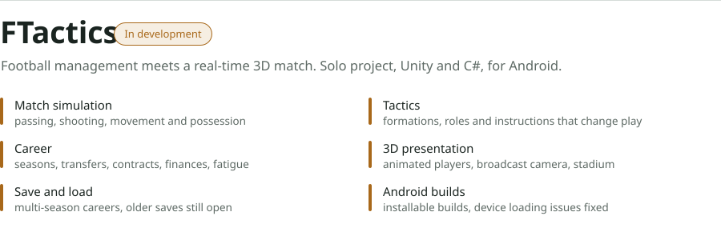

<picture>
  <source media="(prefers-color-scheme: dark)" srcset="assets/hero-dark.svg">
  
</picture>

 

<a href="https://keremsu.github.io/FTactics-Showcase/">
  <picture>
    <source media="(prefers-color-scheme: dark)" srcset="assets/ftactics-dark.svg">
    
  </picture>
</a>

[Watch the 1-minute demo](https://keremsu.github.io/FTactics-Showcase/) &nbsp;&nbsp; [How it's built](https://github.com/keremSU/FTactics-Showcase#technical-approach) &nbsp;&nbsp; [What's still unfinished](https://github.com/keremSU/FTactics-Showcase/blob/main/DEVELOPMENT.md)

 

### Other projects

| | |
|---|---|
| [Library Borrowing Database](https://github.com/keremSU/library-database-system) | MySQL schema with triggers and stored procedures, plus MongoDB support tickets, behind a PHP interface |
| [FPGA UART Countdown Timer](https://github.com/keremSU/fpga-uart-countdown-timer) | Type a time over serial, watch it count down on a 7-segment display. Verilog on a Gowin FPGA |
| [Wear2Weather](https://github.com/keremSU/CS-310-Group-Project-Group06) | Team project. Outfit suggestions from weather and personal comfort; I led testing and QA. Flutter, Firebase |
| [Smart Habit Tracker](https://github.com/keremSU/smart-habit-tracker) | A small Flutter app for students to track daily habits |

### What I work with

Unity, C# and Blender for FTactics; Flutter and Firebase for mobile apps; MySQL, MongoDB and PHP for databases; Verilog for hardware coursework.
